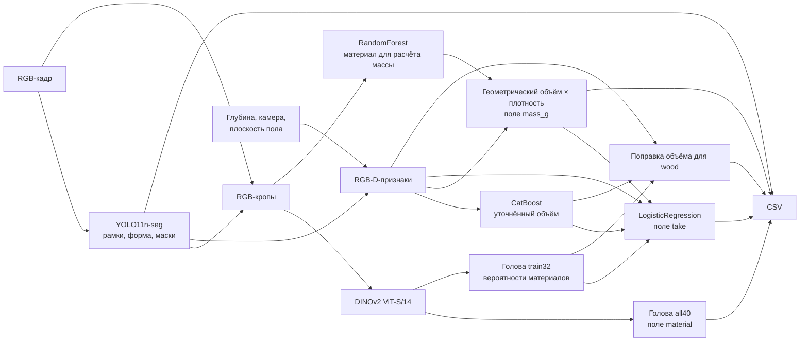

# OneCloud · Astramis — «Что под щёткой?»

Решение команды OneCloud для хакатона Центрального университета «Научная орбита». По кадру RGB-D робот-пылесос находит предметы на полу, определяет их форму и материал, оценивает объём и массу и решает, можно ли убрать каждый предмет. [Описание кейса на StackMoreLayers](https://stackmorelayers.ai/competitions/astramis)

**Последняя оценённая отправка — `submission_volume_wood_v1.csv`, публичный Score 78,5013.** StackMoreLayers принял файл 22 ноября 2026 года в 12:27 МСК. Эталонный CSV доступен участникам и организаторам через StackMoreLayers. [Порядок скачивания и SHA-256](submissions/README.md) [Карточка отправки №17382](https://stackmorelayers.ai/submissions/17382)

[Презентация команды](OneCloud.pdf)

## Как работает решение



1. **Детекция и сегментация.** Замороженный YOLO11n-seg выдаёт `xyxy`, уверенность, класс формы `bulk` или `solid` и контур маски. Инференс на CPU, `imgsz=640`, `conf=0.10`, NMS `iou=0.50`. Рамки шириной или высотой менее 2 пикселей отбрасываются. Контур округляется до пикселей и растеризуется средствами OpenCV.
2. **Материал.** По неокруглённым рамкам вырезаем RGB-кропы. Нижнюю и верхнюю границы округляем соответственно вниз и вверх и ограничиваем размером кадра. Для DINOv2 применяем bicubic resize до 256 по короткой стороне, центральный кроп 224 × 224 и нормализацию ImageNet. Замороженный ViT-S/14 даёт CLS-вектор из 384 компонент. Линейная голова `head_all40.npz` определяет поле `material` среди `metal`, `wood`, `plastic`, `glass`, `paper`, `mineral`. Вероятности отдельной головы `head_train32.npz` используются в двух последующих этапах.
3. **Геометрия и объём.** Из ненулевой глубины в маске восстанавливаем 3D-точки по параметрам камеры. Для ячеек пола 4 × 4 мм интегрируем высоты над плоскостью. Этот расчёт даёт базовый объём, с резервным значением 420 мл. CatBoost оценивает логарифм отношения истинного объёма к базовому. Помимо базового объёма модель использует площадь проекции, размеры и пропорции рамки, площадь и компактность маски, квантили высот, доли пропусков и выбросов, шум глубины и класс формы. При срабатывании резерва используется базовая оценка.
4. **Масса и `take`.** Масса сохраняет исторический расчёт `геометрический объём × плотность`. Для выбора плотности используется сохранённый RandomForest с HSV-гистограммами, статистиками RGB, признаками размеров кропа и дисперсией лапласиана. Строгая модель `StandardScaler → LogisticRegression` принимает `log1p` объёма CatBoost и массы, отношение массы к 500 г, шесть вероятностей DINOv2, признак `solid` и площадь проекции. Значение `take=1` записываем при вероятности строго больше 0,5.
5. **Поправка объёма.** Если `wood` входит в две наиболее вероятные категории головы train32, а валидный q95 высоты лежит в интервале 0–30 мм, умножаем уже округлённый объём CatBoost на 0,75 точной десятичной арифметикой. Поправка меняет только `volume_ml`. На этапе 8 она затронула 31 детекцию в 24 кадрах. [Отчёт этапа 8](experiments/astramis/volume_stage8/REPORT.md)

## Обучение и валидация

- Для разработки использовали фиксированное разбиение по физическим предметам. В train было 32 предмета и 214 кадров, включая 49 пустых. В independent val было 8 других предметов и 49 непустых кадров. Детектор зафиксирован с ранней версии команды. Сохранённый чекпойнт указывает исходные веса `yolo11n-seg.pt`, 10 эпох, размер 640, batch 16, AdamW, `lr0=0.001667` и `seed=0`. RandomForest обучен на 165 train-кропах. Ноутбук `Detection_v1.ipynb` фиксирует последующую проверку дедупликации.
- Головы DINOv2 обучались как сбалансированные линейные классификаторы на CLS-векторах RGB-кропов с разметкой материала. Параметр регуляризации для обеих сохранённых голов — `C=0.0001`. Голова train32 использовалась в независимой проверке. Голова all40 обучена на всех 40 доступных предметах для экспорта метки материала.
- CatBoost обучался на сопоставленных детекциях train32 с валидной геометрией. Каждый физический предмет получил равный суммарный вес. Конфигурация включала 120 итераций, глубину 3, `learning_rate=0.04`, `l2_leaf_reg=8`, `seed=2026`.
- Строгая модель `take` обучалась с L2-регуляризацией, `C=1` и `class_weight=balanced`. В обучении использованы геометрический объём и групповые out-of-fold вероятности материала. Для инференса в признак объёма передаётся оценка CatBoost. [Отчёт этапа 3](experiments/astramis/take_stage3/REPORT.md)

## Результаты

Официальные публичные оценки StackMoreLayers. Метрика взвешивает детекцию D (40%), материал M (20%), объём V (25%) и решение S (15%).

| Версия | Публичный Score | Отправка |
| --- | ---: | --- |
| YOLO11n-seg, RandomForest и базовая геометрия | 71,5128 | [№16750](https://stackmorelayers.ai/submissions/16750) |
| DINOv2 для поля материала | 75,8533 | [№17140](https://stackmorelayers.ai/submissions/17140) |
| CatBoost для объёма | 76,5852 | [№17150](https://stackmorelayers.ai/submissions/17150) |
| Строгая модель `take` | 78,2518 | [№17175](https://stackmorelayers.ai/submissions/17175) |
| Эксперимент с формой от DINOv2 | 73,7983 | [№17310](https://stackmorelayers.ai/submissions/17310) |
| Поправка объёма для wood поверх №17175 | **78,5013** | [№17382](https://stackmorelayers.ai/submissions/17382) |

YOLO11s-seg дала −4,3841 балла на локальной независимой выборке. Снижение порога детекции добавляло ложные срабатывания без новых сопоставлений. Плоский стекинг `take` отклонён по grouped OOF. Отдельная DINOv2-голова формы дала противоположные эффекты на локальных выборках и снизила публичный Score. Этап 7 был аудитом ошибок. Поправка wood на этапе 8 дала локально +0,4206 на grouped OOF и +1,3089 на independent val. [Журнал экспериментов](EXPERIMENT_LOG.md)

## Подготовка среды

Проверенная конфигурация — Linux, Python 3.13.15, CPU 2, версии из [`requirements.txt`](requirements.txt). В StackMoreLayers CatBoost 1.2.8 находился в `runs/rgbd_volume_stage2/deps`. Команды установки для нового окружения с Python 3.13.

```bash
python3.13 -m venv .venv
source .venv/bin/activate
python -m pip install -r requirements.txt
python -m pip install --no-deps ultralytics==8.4.216
```

Последняя команда использует уже установленные CPU-зависимости и сохраняет `opencv-python-headless` как единственный пакет OpenCV. Командные модели и локальные исходники DINOv2 подготовьте по [инструкции для весов](models/README.md). Скачивание зависимостей и открытых весов выполняется на этапе подготовки.

## Запуск инференса

1. Получите пакет данных Astramis через организаторов или [раздел данных соревнования](https://stackmorelayers.ai/competitions/astramis/data).
2. Найдите каталог `dataset/` с `camera.json`, `densities.csv` и `real/test/`. Каждый подкаталог теста содержит `color.png` или `color.jpg`, 16-битный `depth.png` с глубиной в миллиметрах и `meta.json` с `floor_plane`. Укажите отдельно выданный организаторами `sample_submission.csv`. Из него берётся порядок кадров.
3. Для побайтовой проверки скачайте CSV №17382 и сохраните его по [инструкции](submissions/README.md). Параметр `--reference` нужен для сравнения с эталоном.
4. Из корня репозитория запустите команду. Путь вывода должен быть свободен.

```bash
PYTHONPATH=src python -m astramis \
  --data /path/to/dataset \
  --sample /path/to/sample_submission.csv \
  --models models \
  --dino-source vendor/dinov2-7764ea0f912e53c92e82eb78a2a1631e92725fc8 \
  --output reproduced.csv \
  --reference submissions/submission_volume_wood_v1.csv
sha256sum reproduced.csv submissions/submission_volume_wood_v1.csv
cmp reproduced.csv submissions/submission_volume_wood_v1.csv
```

CSV содержит столбцы `image_id,prediction`. Значение `prediction` равно `none` для пустого кадра. В остальных кадрах предсказания разделены `;`. Порядок полей показан ниже.

```text
x1 y1 x2 y2 score form material volume_ml mass_g take
```

## Проверка воспроизводимости

22 ноября 2026 года запустили опубликованный код в отдельном процессе на CPU в StackMoreLayers. Прогон прочитал исходные RGB-D-кадры, параметры камеры, таблицу плотностей и семь сохранённых моделей. Тестовые кэши, архивные маски, старые предсказания и метки теста в этом прогоне не использовались. Попыток сетевого подключения или разрешения имён под Python-аудитом не было. Проверили синтаксис семи модулей, импорты и загрузку всех моделей. Официальный `score.py` принял 137 уникальных строк в порядке примера, с 144 детекциями и 19 пустыми кадрами.

| Артефакт | SHA-256 |
| --- | --- |
| Ранний RF-кандидат `material_simple_v1` | `5ad2911ca91a485f0dc140bd5ff0aa3b34c4108f882854f2bf95ed26ad4051d6` |
| Этап 1, DINOv2 `material` | `d8317647cabce8146575803080fa1df2e87c3e7b0cb9280647e8a021ac2dd7d0` |
| Этап 2, CatBoost `volume_ml` | `c046f1c5391041f62134606691a4e017e007fce70db2d33ae4752b3ecd7289bb` |
| Этап 3, строгий `take` | `2c55a9bf5bab0e9118c8ea7cbee69f0d392e47712f17c288d7bee034a19dafd1` |
| Этап 8, CSV из официальной отправки №17382 | `2975526dadff6a4c0723d1e31d2ef41cb2143cb9f67510feda52243bb1b00950` |
| Этап 8, заново рассчитанный CSV | `2975526dadff6a4c0723d1e31d2ef41cb2143cb9f67510feda52243bb1b00950` |

Все пять SHA-256 совпали с историческими артефактами. Исходный [сборщик этапа 8](experiments/astramis/volume_stage8/make_test_candidate.py) отдельно воспроизвёл тот же CSV с архивными масками и базой этапа 3, но со свежими эмбеддингами DINOv2. Единая команда заново вычисляет и эти исходные признаки. Сверка официальных файлов этапов 3 и 8 подтвердила, что различаются только 31 значение `volume_ml` в 24 кадрах.

## Ограничения

- Подтверждён результат на исходном тесте с сохранёнными весами и указанной CPU-средой. Чистая установка вне StackMoreLayers и запуск на GPU отдельно не проверялись.
- Для запуска нужны данные соревнования и доступ к командным весам. Доступ к закрытой части рейтинга и итоговое место этой проверкой не устанавливались.
- В независимой выборке было восемь предметов, три представленных материала и один тяжёлый предмет. Для низкопрофильных минеральных предметов поправка wood может уменьшить качество. Использование сохранённой массы объясняет, почему поле `mass_g` может отличаться от произведения экспортированных материала, плотности и объёма.

## Состав репозитория

- [`src/astramis/`](src/astramis/) — единая команда инференса из RGB-D, модели и сериализация.
- [`notebooks/`](notebooks/) — исходные ячейки пяти исследовательских ноутбуков. Выводы ячеек очищены перед публикацией.
- [`experiments/astramis/`](experiments/astramis/) — исторические скрипты этапов 1, 2, 3, 7 и 8 и отчёты. Скрипты ориентированы на исходную рабочую область StackMoreLayers.
- [`models/`](models/) — источники и контрольные суммы семи артефактов.
- [`submissions/`](submissions/) — ссылка для скачивания официального CSV №17382 и его SHA-256.
- [`EXPERIMENT_LOG.md`](EXPERIMENT_LOG.md) — решения по экспериментам и сводные метрики.
